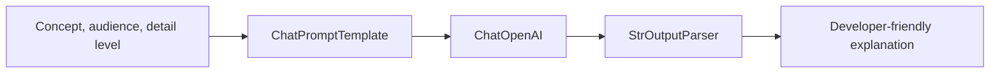

# LangChain Explained for Developers: Build an LLM Chain with Python

A small, practical Python project that demonstrates how to compose a reusable LLM pipeline with LangChain. It accepts a technology concept, a target audience, and a detail level, then asks an OpenAI chat model to explain the concept in four sections: definition, how it works, practical example, and common pitfalls.

The central idea is:

```python
chain = prompt | model | parser
```

The composition links a `ChatPromptTemplate`, a `ChatOpenAI` model, and `StrOutputParser` into a reusable runnable chain.

## What you will learn

- Define a reusable prompt with named input variables.
- Call an OpenAI chat model with LangChain's provider integration.
- Convert the model response to plain text with `StrOutputParser`.
- Understand the composition operator (`|`) and `.invoke()`.
- Keep model configuration in environment variables.
- Test prompt construction and chain wiring without making a live model call.

## Architecture



## Project structure

```text
langchain-llm-chain-python/
├── README.md
├── requirements.txt
├── pyproject.toml
├── .env.example
├── .gitignore
├── src/
│   └── llm_chain_app/
│       ├── __init__.py
│       ├── config.py       # Environment configuration
│       ├── prompts.py      # Reusable prompt template
│       ├── chains.py       # Compose prompt, model and parser
│       └── cli.py          # Command-line interface
├── tests/
│   ├── test_prompts.py
│   └── test_chain.py
├── docs/
│   └── architecture.md
└── .github/workflows/tests.yml
```

## Requirements

- Python 3.10, 3.11, or 3.12
- An OpenAI API key with access to the configured chat model
- Git, if cloning from GitHub

The sample configuration defaults to `gpt-4o-mini`. Select a model available to your API account and confirm current availability and pricing with the provider. API usage may incur charges.

## Quick start

### 1. Clone the repository

```bash
git clone https://github.com/vicky123444/langchain-llm-chain-python.git
cd langchain-llm-chain-python
```

### 2. Create and activate a virtual environment

**Windows PowerShell**

```powershell
py -3.11 -m venv .venv
.\.venv\Scripts\Activate.ps1
```

If PowerShell activation is blocked, open Command Prompt and run `.venv\Scripts\activate.bat`.

**macOS / Linux**

```bash
python3 -m venv .venv
source .venv/bin/activate
```

### 3. Install dependencies

```bash
python -m pip install --upgrade pip
pip install -r requirements.txt
pip install -e .
```

### 4. Configure the API key

Copy `.env.example` to `.env`.

PowerShell:

```powershell
Copy-Item .env.example .env
```

macOS/Linux:

```bash
cp .env.example .env
```

Edit `.env` locally:

```dotenv
OPENAI_API_KEY=replace-with-your-own-api-key
OPENAI_MODEL=gpt-4o-mini
```

Never commit the real `.env` file or paste an API key into source code, screenshots, issues, or blog posts. The repository ignores `.env`.

### 5. Run the example

```bash
python -m llm_chain_app.cli --concept "Spring Boot Circuit Breaker" --audience "Java microservices developer" --detail-level "Intermediate"
```

The application asks the model to return four sections:

1. **Definition** — a concise definition.
2. **How it works** — the key idea and flow.
3. **Practical example** — a developer-oriented use case.
4. **Common pitfalls** — implementation or design mistakes to watch for.

Output quality depends on the prompt and model. Validate technical guidance against reliable documentation before using it in production.

## How the chain works

In `src/llm_chain_app/chains.py`, the pipeline is assembled as:

```python
prompt = build_prompt_template()
model = ChatOpenAI(model=resolved_model, temperature=temperature)
parser = StrOutputParser()

chain = prompt | model | parser
```

- **Prompt:** accepts `concept`, `audience`, and `detail_level` and formats chat messages.
- **Model:** sends those messages to the configured OpenAI chat model.
- **Parser:** returns a plain string rather than a model-specific message object.
- **Invocation:** `chain.invoke({...})` runs the composed pipeline synchronously.

Keeping these steps separate makes the example easier to understand, adapt, and test. Later projects can extend the pattern with structured output, retrieval, batching, streaming, or multi-step workflows.

## Run the tests

```bash
pytest
```

The tests validate prompt variables and formatted values. The chain test substitutes a fake LangChain `Runnable` for the live model, so tests do not require a valid API key or incur model usage charges. GitHub Actions runs tests with Python 3.10, 3.11, and 3.12 on pushes and pull requests.

## Troubleshooting

**`OPENAI_API_KEY is missing`**  
Confirm that `.env` exists at the project root and contains your key. Make sure you activated the intended virtual environment.

**`No module named llm_chain_app`**  
Install dependencies and run `pip install -e .` from the repository root.

**Authentication, quota, or model errors**  
Check the key, billing/quota status, network access, and whether the configured model is available to your account. Avoid retry loops that might create unexpected usage costs.

**Tests fail with missing dependencies**  
Run `pip install -r requirements.txt` and `pip install -e .` inside the activated environment, then retry `pytest`.

## Security, cost, and reliability notes

- API calls can incur charges; monitor provider usage while learning.
- The model may generate incorrect, incomplete, or outdated information. This example does not fact-check answers.
- Keep `.env` local. Rotate the key immediately if it is accidentally committed or exposed.
- Do not send confidential source code or private data to a hosted model unless your organization permits that use.
- This is a learning example, not a production-ready service. Add input validation, observability, timeouts/retries, rate limits, error handling, and evaluation before deploying it for users.

## Next steps

1. Add a Pydantic schema and use structured output.
2. Build a second chain that summarizes a technical topic into interview notes.
3. Compose multiple steps into a multi-step LLM workflow.
4. Add retrieval so responses can be grounded in approved documents.

## Official references

- [LangChain documentation](https://docs.langchain.com/)
- [LangChain Core reference](https://reference.langchain.com/python/langchain-core)
- [ChatPromptTemplate reference](https://reference.langchain.com/python/langchain-core/prompts/chat/ChatPromptTemplate)
- [ChatOpenAI integration guide](https://docs.langchain.com/oss/python/integrations/chat/openai)
- [LangChain OpenAI API reference](https://reference.langchain.com/python/langchain-openai/langchain_openai)

## Companion article

This repository accompanies the Vikram Tech Lab article **“LangChain Explained for Developers: Build Your First LLM Chain with Python.”**
